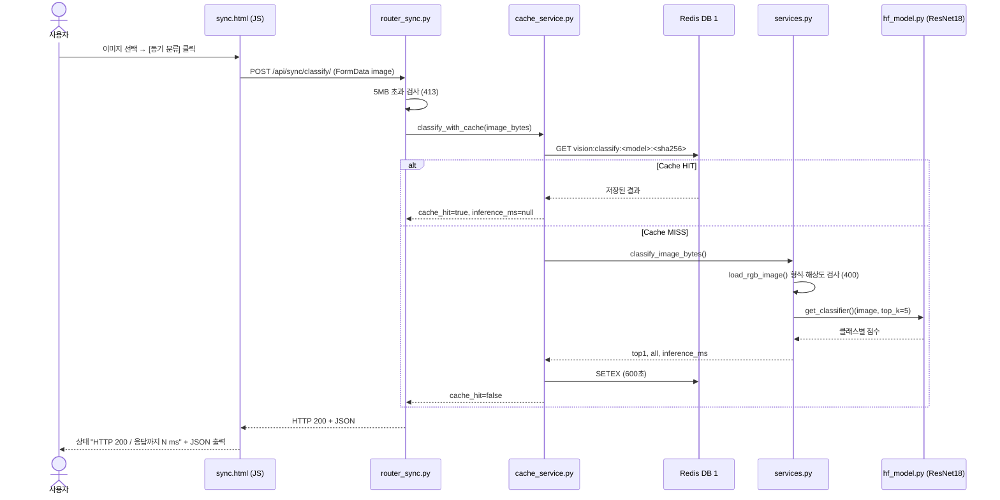
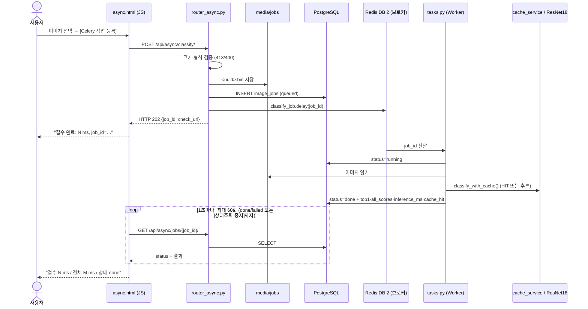

# AI 분석 버튼 처리 흐름

> 근거: `templates/sync.html`, `templates/async.html`, `ai/*.py` (02 제공 코드) 및 실제 실행 결과

## A. 동기 버튼 ("동기 분류") 시퀀스

## B. 비동기 버튼 ("Celery 작업 등록") 시퀀스

[상태조회 중지] 버튼은 **브라우저의 폴링만** 멈춘다. Worker의 작업은 계속 진행된다.

## C. 코드 대응표

| 단계 | 파일 | 함수·처리 | 다음 단계 |
|---|---|---|---|
| 동기 1 | `templates/sync.html` | `fetch('/api/sync/classify/')`, 응답 시간 측정(`performance.now`) | 동기 2 |
| 동기 2 | `ai/router_sync.py` | `classify_sync()` — 크기 검사 | `classify_with_cache()` |
| 동기 3 | `ai/cache_service.py` | `classify_with_cache()` — Redis 조회·저장, Redis 장애 시 추론으로 폴백 | HIT 반환 또는 동기 4 |
| 동기 4 | `ai/services.py` | `load_rgb_image()` → `classify_image_bytes()` | `get_classifier()` |
| 동기 5 | `ai/hf_model.py` | `get_classifier()` — 프로세스당 1회 로딩(`lru_cache`), CPU | 결과 반환 |
| 비동기 1 | `templates/async.html` | 접수 `fetch` → 1초 간격 폴링 | 비동기 2 |
| 비동기 2 | `ai/router_async.py` | `enqueue_classify()` — 저장·DB `queued`·`delay()` | 202 |
| 비동기 3 | `ai/celery_app.py` | 브로커 `redis://…/2`, `include=["ai.tasks"]` | Worker |
| 비동기 4 | `ai/tasks.py` | `classify_job()` — `running` → 추론 → `done`/`failed` | DB |
| 비동기 5 | `ai/router_async.py` | `get_job()` — DB 조회 | 화면 |

## D. 실제 실행 관찰

| 경로 | 관찰 | 근거 |
|---|---|---|
| 동기 MISS | 200, `inference_ms` 25.29 | API 응답 |
| 동기 HIT | 200, `inference_ms: null` | API 응답 |
| 비동기 (캐시 HIT, job 6) | **접수 113ms / 전체 1,135ms** / done | 웹 화면 |
| 비동기 (캐시 MISS, job 7) | **접수 107ms / 전체 4,155ms** / done | 웹 화면, Worker 첫 추론(모델 로딩 3,505ms 포함) |
| Worker | `received` → `succeeded in 3.48s` (job 1) | Celery 로그 |
| 최종 캡처 — 동기 | MISS: HTTP 200 / 3,453 ms (`inference_ms` 3,412, 프로세스 첫 추론) → 같은 이미지 HIT: **13 ms**, `cache_hit: true` | `evidence/ui_sync.png`, `cache_hit.png` |
| 최종 캡처 — 비동기 | 접수 **42 ms** / 전체 4,094 ms / done, job 31, `cache_hit: false` (Worker 직접 추론, 첫 추론) | `evidence/ui_async.png` |

- 비동기 "전체" 시간에는 **화면의 1초 폴링 간격**이 포함된다. 캐시 HIT인 job 6도 전체 1,135ms인 이유이다.
- 정확한 비교 수치는 [산출물 6](06_성능비교_보고서.md)의 반복 측정을 따른다.

## E. 동기 vs 비동기 비교

| 항목 | 동기 | 비동기 |
|---|---|---|
| HTTP 응답에 결과 포함 | 예 | 아니오 (202 접수만) |
| 사용자 대기 | 추론이 끝날 때까지 | 접수까지만, 이후 폴링 |
| 추론 실행 프로세스 | FastAPI 서버 | Celery Worker |
| DB 기록 | 없음 | `image_jobs` |
| 사용 모델 | 같은 `artifacts/beans_resnet18` | 같음 |
| 캐시 | Redis DB 1 공유 | Redis DB 1 공유 |

**증빙:** `reports/evidence/ui_sync.png`, `ui_async.png`, `celery_log.png`
