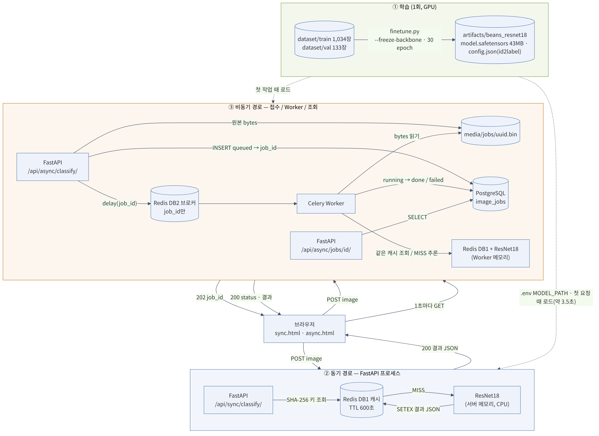

# 콩잎 질병 분류 Vision AI API 서비스 기술보고서

> **작성 상태: 최종.** 모든 수치는 실제 실행·측정 결과이다. 증빙은 `reports/evidence/`.

## 1. 프로젝트 정보

| 항목 | 내용 |
|---|---|
| 프로젝트 | ResNet18 기반 Beans 3클래스 분류 및 동기·비동기 서빙 |
| 입력 | JPG / PNG / WEBP, 5MB 이하 |
| 출력 | `angular_leaf_spot` / `bean_rust` / `healthy` |
| 모델 | `microsoft/resnet-18` → Head-only Fine-tuning → `artifacts/beans_resnet18` |
| 실행 구조 | FastAPI·Celery (WSL 가상환경) + Redis·PostgreSQL (Docker Compose) |
| Docker | Docker Desktop 4.97.0 (Engine 29.9.2, Compose v5.6.1), `redis:7.4-alpine`, `postgres:17-alpine` |
| 개발 환경 | Windows + WSL2 Ubuntu, Python 3.11.17 |
| 학습 / 추론 장치 | 학습: GPU (RTX 3060 12GB, CUDA) / 추론(서빙): CPU (`device=-1` 고정) |

## 2. 모델 학습 결과 요약

| 항목 | 결과 |
|---|---|
| 학습 방식 | Backbone Freeze / Head-only Fine-tuning |
| 학습 코드 | 제공 `training/finetune.py` 원본 (옵션 `--epochs 30`만 변경) |
| Train / Validation | 1,034 / 133 |
| Best Validation Accuracy | **0.9549** (127/133, 27 epoch) |
| 비교: 3 epoch | 0.8421 (112/133) |
| 정상 vs 질병 / 질병 종류 구분 | Val 0.977 / 0.955, **Test 0.969 / 0.884** |
| **Test 성능 (1회 평가)** | **Accuracy 0.8984 (115/128)**, Macro F1 0.899 |
| 모델 파일 | `artifacts/beans_resnet18/model.safetensors` |

- 근거: [산출물 1](01_FineTuning_결과보고서.md), `artifacts/beans_resnet18/training_report.json`
- 한계: 동일 seed에서도 실행 간 결과 차이가 관찰되었다. GPU(cuDNN) 연산의 비결정성이 원인으로 추정되며, epoch 증가의 효과를 단정하지 않는다.

## 3. 아키텍처 및 데이터 흐름

> 상세 흐름: [동기 요청→응답](figures/flow_2_sync.png), [비동기 접수·처리·조회](figures/flow_3_async.png)

- **동기:** Browser → FastAPI → Redis 캐시(DB 1) → (MISS) ResNet18 → JSON 200
- **비동기:** Browser → FastAPI → `media/jobs` 저장 → PostgreSQL `queued` → Redis 브로커(DB 2) → Celery Worker → 캐시/ResNet18 → PostgreSQL `done` → 브라우저 폴링
- **모델은 서버와 Worker에 각각 로드**되며, 프로세스별 첫 요청에 약 3.4~3.6초가 걸린다 (모델 로딩).
- 02 문서는 web·worker까지 Docker로 실행하지만, 평가가이드 기준에 맞춰 Redis·PostgreSQL만 Docker로 실행하였다.
- 근거: [산출물 2](02_시스템_아키텍처.md)

## 4. API·DB 설계

| API | 성공 | 실패 |
|---|---|---|
| `GET /health` | 200 | — |
| `POST /api/sync/classify/` | 200 (결과 포함) | 400, 413 |
| `POST /api/async/classify/` | **202 (접수만)** | 400, 413, 503 |
| `GET /api/async/jobs/{id}/` | 200 (`queued`/`running`/`done`/`failed`) | 404 |

- DB: PostgreSQL `image_jobs` 1개 테이블. **비동기 작업만 기록**, 이미지 원본은 `media/jobs/`에 파일로 저장하고 경로만 기록
- 상태 전이: `queued → running → done` / 실패 시 `failed`
- 근거: [산출물 3](03_API_명세서.md), [산출물 4](04_DB_구조_작업이력.md)

## 5. 실제 버튼 처리 검증

| 버튼 | 관찰 결과 |
|---|---|
| 동기 분류 | 200, `cache_hit: false`, `inference_ms` 25.29ms / 재전송 시 `cache_hit: true`, `inference_ms: null` |
| Celery 작업 등록 | 접수 107ms(202) → done, 화면 전체 4,155ms (Worker 첫 추론의 모델 로딩 포함) |
| 캐시 공유 | 동기로 분류한 이미지를 비동기로 보내면 Worker가 캐시를 재사용 (`cache_hit: true`) |
| 서버·Worker 일치 | 캐시를 비운 뒤 같은 이미지를 각각 직접 추론 → 둘 다 angular_leaf_spot 0.8439902 |

- 근거: [산출물 5](05_AI버튼_처리흐름.md)

## 6. 실제 성능 비교

조건: CPU(i7-12700) 추론, 조건별 5회 중앙값, 워밍업 제외, MISS는 매회 다른 이미지 + 캐시 초기화, 상태 조회 0.2초 간격

| 항목 | 중앙값 |
|---|---:|
| Sync MISS HTTP 완료 | 24.34 ms |
| Sync HIT HTTP 완료 | 2.27 ms |
| Async MISS HTTP 접수 | 9.96 ms |
| Async MISS 최종 확인 | 214.27 ms |
| 추론 시간 (서버 / Worker) | 19.90 / 17.86 ms |
| 프로세스 첫 요청 (모델 로딩) | 약 3,400 ms |

- **비동기 접수 응답은 약 59~66% 빠르지만(2회 측정), 결과 확인은 약 190 ms 늦다.** 추론 가속이 아니라 접수와 처리를 분리한 효과이다.
- **캐시 HIT은 동기 응답을 90.67% 단축**하였다.
- CPU 추론이 약 20 ms로 빨라 이 환경에서 비동기의 이점은 작다. 비동기는 추론이 길거나 동시 요청이 많을 때 의미가 있다 (동시성은 미측정).
- 근거: [산출물 6](06_성능비교_보고서.md), `reports/data/timings.csv`

## 7. 기능 테스트·오류 조치

- 01 단계 오류 6건(E-01~E-06), 02 단계 오류 5건(E-07~E-11), 선택 실험 오류 5건(X-01~X-05)의 원인·조치를 기록하였다.
- 02 실환경 통합 확인: 비동기 접수·완료, Redis·PostgreSQL 연결, Worker 처리, 캐시 MISS→HIT, 동기→비동기 캐시 공유, 서버·Worker 결과 일치 (T-09~T-16 PASS), Worker 중지 시 queued 유지 → 재시작 후 처리(T-21), Test 세트 1회 평가(T-22)
- 주요 교훈: 패키지는 `python -m pip`로 venv에 설치 / 모델 경로는 `training_report.json`으로 확인 / 모델 교체 후 서버·Worker 모두 재시작 / 프로세스 간 비교는 캐시를 비우고 수행 / 마스크는 이미지로 육안 검증
- 근거: [산출물 7](07_기능테스트_오류분석.md)

## 8. 교과 9 OpenCV 성능 개선 — 구현 및 측정 결과

> 평가가이드 6장의 선택 제안 항목을 **설계 제안이 아니라 실제로 구현·측정**하였다. 제공 코드는 수정하지 않았고, 모든 실험은 `tools/`의 별도 스크립트와 동일 Validation 133장으로 수행하였다. Test는 사용하지 않았다.

### 8-1. 구현한 기법

| 기법 | 구현 | 결과 |
|---|---|---|
| 라플라시안 선명도 마스크 | 구현 | **실패** — 밭 사진에서 잎 대신 흙 선택 (질감을 측정하기 때문) |
| Lab a* 색 마스크 + 선명도 | 구현 | **폐기** — 흐린 녹색 배경·황변 잎에서 실패 |
| **GrabCut 잎 ROI 마스크** | 구현 | 실제 사진 8장에서 잎만 선택 (육안 확인) |
| HSV 색상 특징 (히스토그램, 황색·갈색·녹색 비율) | 구현 | 22~24개 특징 |
| 색상 특징 + RandomForest | 구현 | 아래 표 |
| 배경 제거 이미지로 CNN 재학습 | 구현 | 아래 표 |
| CNN + 색 규칙 (`확인 필요` 분리) | 구현 | 아래 표 |
| CNN + 색 ML 융합 | 구현 | 아래 표 |
| Grad-CAM | **미구현** | — |

### 8-2. 측정 결과 (Validation 133장)

| 방법 | Val Accuracy | 질병 종류 구분 |
|---|---:|---:|
| **CNN Full Fine-tuning 10 epoch (선택 실험)** | **0.9925** (평균 0.967) | **0.989** |
| CNN Head-only 30 epoch (서비스 모델) | 0.9549 (평균 0.937) | 0.955 |
| CNN, 배경 제거 이미지로 학습 | 0.9398 | 0.921 |
| CNN + 색 확률 융합 | 0.9398 | 0.933 |
| CNN + 색 특징 융합 | 0.9173 | 0.910 |
| 색 단독 (선명도 마스크) | 0.8346 | 0.854 |
| 색 단독 (전체 이미지) | 0.8271 | 0.798 |
| 색 단독 (GrabCut 잎 마스크, 색 22개) | 0.8045 | 0.764 |
| CNN + 색 규칙 | 자동 처리분 0.9752 (9% 보류) | — |

### 8-3. 결론

0. **가장 큰 개선은 학습 방식(Full Fine-tuning)에서 나왔다.** 같은 코드에 옵션만 바꿔 평균 약 3%p 향상, 반점병 오답 4 → 0. 단 epoch 간 변동이 커서 Best 값(0.9925)은 낙관적이다. 서비스 모델은 Head-only를 유지하고 Full은 선택 실험으로 기록한다 (보고서 10, 6-6).
1. **OpenCV 색상 특징을 CNN에 더해도 정확도가 오르지 않았다.**
2. **CNN은 배경이 아닌 잎을 보고 판단한다.** 배경을 지운 학습에서도 2장 차이였다.
3. **색상 특징은 정상/질병 판별(0.93)에는 유효하나, 질병 종류 구분(0.76)에는 한계가 있다.** CNN은 같은 잎 영역에서 0.92~0.96으로 구분하여, 색 이외의 정보(모양·질감 추정)를 사용하는 것으로 보인다 (미검증).
4. **색 규칙은 사람 검토가 있는 운영 환경에서만 의미가 있다.** 9%를 보류하면 자동 처리 오류가 6 → 3건으로 줄지만, 보류된 12장 중 9장은 CNN이 맞힌 이미지였다.
5. **마스크 품질은 육안으로 검증해야 한다.** 선명도 마스크의 결함은 정확도 숫자만으로는 드러나지 않았다.

- 근거: [보고서 09](09_실험_선명도마스크_색상특징_RandomForest.md), [보고서 10](10_실험_CNN_잎마스크_융합.md)
- 성능 개선 주장: OpenCV 기법은 **없음** (융합·규칙이 CNN 단독의 전체 정확도를 넘지 못함). Full Fine-tuning은 동일 Validation 기준 **평균 약 3%p 우위**(epoch·학습률 조건이 함께 달라 원인은 단정하지 않음).

## 9. 최종 판정 및 한계

| 항목 | 상태 |
|---|---|
| 데이터 준비 | 완료 |
| Fine-tuning·모델 저장 | 완료 |
| 동기 API | 완료 (200, 캐시 MISS/HIT 확인) |
| 비동기·Redis·PostgreSQL | 완료 (202 → done, DB 기록, 캐시 공유) |
| 성능 측정 | 완료 (조건별 5회) |
| 산출물 8종 + README | 작성 완료, 증빙 캡처 18장 |

**한계**
- Test 정확도가 Validation보다 5.65%p 낮음 — Validation 기준 epoch 선택의 낙관 편향. Test 오답의 9/13이 반점병 ↔ 녹병 혼동
- Validation 133장 단일 분할 (1장 = 약 0.75%p)
- CNN 학습 결과의 실행 간 차이 원인 미확인

**추후 과제**
- Grad-CAM으로 CNN 판단 근거 시각화
